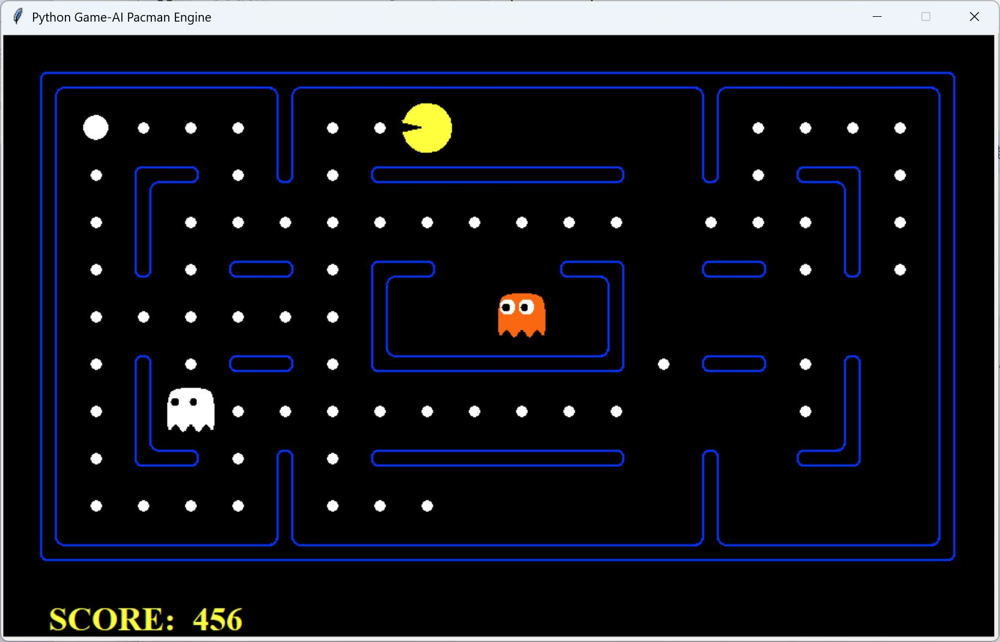

# 🎮 Pacman Engine：CE811 智能体挑战

让智能体自己玩吃豆人：寻找食物、规划路线、躲避鬼魂，并抓住胶囊带来的反击机会！👻

本项目基于 UC Berkeley 的 Pacman 引擎，完成 CE811 智能体题目，涵盖**曼哈顿距离、一步前瞻、Dijkstra 路径规划和动态避险策略**。

## 🏆 完成情况

- ✅ **全部题目已完成**。
- 🎯 **历史成功率：9/10（90%）**。
- ⭐ **历史平均游戏得分：760.8 分**。
- 🏁 **尚未拿到满分**，欢迎提交 PR 交流高分方案！

> 💡 以上为历史测试记录，供参考；不同智能体、地图与测试配置下的成绩可能不同。游戏得分、通关率与课程评分是不同指标。

## 📸 运行效果

综合智能体 `ce811MyBestAgent` 在 `mediumClassic` 地图中的真实运行画面：



*截图日期：2026-11-03。画面中的 456 分为局中得分，不是最终得分或平均分。*

<details>
<summary>🔎 查看截图使用的运行命令</summary>

```bash
python pacman.py -l mediumClassic -p ce811MyBestAgent -f --frameTime 0.3 -z 1.5
```

</details>

## 🚀 快速开始

在项目根目录执行以下命令。原项目使用 **Python 3.12.7**，智能体依赖 **NumPy**，图形界面需要 **Tkinter**。

### 1. 安装依赖

```bash
python -m pip install numpy
```

### 2. 观看智能体自动闯关 🤖

```bash
python pacman.py -l mediumClassic -p ce811MyBestAgent
```

想自己操作？运行 `python pacman.py` 即可进入键盘模式。⌨️

### 3. 测试 10 局，查看成绩 🧪

```bash
python pacman.py -l mediumClassic -p ce811MyBestAgent -g RandomGhost -k 4 -f -q -n 10
```

- `-l mediumClassic`：选择地图。
- `-p ce811MyBestAgent`：选择综合智能体。
- `-g RandomGhost -k 4`：使用随机鬼魂策略，最多 4 个鬼魂。
- `-f`：固定随机种子，方便比较结果。
- `-q`：关闭图形界面。
- `-n 10`：连续运行 10 局。

程序会输出**平均分、地图、逐局分数、胜率和胜负记录**。对比不同方案时，请保留相同的测试配置和完整输出。

## 🧠 智能体如何决策？

项目从简单距离规则逐步发展到路径规划，核心是让 Pacman 在“继续吃豆”和“优先保命”之间做选择。

### 📏 曼哈顿距离与一步前瞻

曼哈顿距离 `|x1 - x2| + |y1 - y2|` 用于快速判断食物、胶囊和鬼魂的远近。它计算简单，但无法体现墙壁造成的绕路。

一步前瞻智能体会枚举合法动作，通过 `generatePacmanSuccessor` 生成后继状态，再综合以下因素评分：

- 🍒 游戏得分与最近食物距离。
- 👻 危险鬼魂的距离：越近，惩罚越大。
- 💊 受惊鬼魂与胶囊的距离：鼓励寻找反击机会。

当前曼哈顿版本从评分最高的动作中随机选择一个。

### 🧭 Dijkstra 路径规划

将可通行格子视为图节点，连接上下左右的相邻格子。使用 `heapq` 优先队列扩展累计代价最小的节点，并记录父节点，再从目标回溯得到行动路线。

基础版本每步代价为 1，用于计算考虑墙壁的最短距离；综合版本会提高鬼魂附近格子的代价，让路线主动绕开高风险区域。

### 🤖 综合策略：选目标 → 规划 → 评估 → 避险

`ce811MyBestAgent` 每回合读取食物、胶囊、鬼魂位置及受惊时间，按以下流程行动：

1. 🎯 **选目标**：寻找最近食物和胶囊；胶囊的曼哈顿距离小于 15 时优先取胶囊，否则选择食物。
2. 🗺️ **规划路线**：格子基础代价为 1，在鬼魂距离 5 以内叠加风险代价，再使用 Dijkstra 搜索路线。
3. ⚖️ **评估动作**：排除停止动作，按 `10 × 最近鬼魂距离 - 最近食物距离` 评分。
4. 🛡️ **动态避险**：存在距离小于 5、受惊时间不大于 1 的鬼魂时，执行避险评分最高的动作；否则沿规划路线前进，路径动作不合法时使用评分动作兜底。

<details>
<summary>🛠️ 风险代价与可改进之处</summary>

每个鬼魂在曼哈顿距离 5 以内，对格子叠加 `(5 - 距离 + 1) × 10` 的代价。

当前综合版本的风险地图和动作距离评分会计入所有鬼魂，受惊状态主要用于触发避险策略。它使用规则与路径搜索，没有训练神经网络，也没有实现多步鬼魂预测或移动历史防循环逻辑。

后续可以探索受惊鬼魂追击、死胡同识别、循环检测和更深的前瞻搜索。

</details>

## 🗂️ 代码导览

从 **`ce811MyBestAgents.py`** 开始，可以直接阅读最终综合策略。

- 🤖 **综合智能体**：`ce811MyBestAgents.py`；`part2/ce811MyBestAgents.py` 为带调试输出的版本。
- 🛡️ **教程智能体**：`ce811TutorialAgents.py`，包含避鬼、胶囊处理、逃跑状态和移动历史等规则。
- 🔭 **一步前瞻**：`ce811Assignment2Agents.py` 和 `part2/1.py` 为曼哈顿方案；`part2/4.py` 为 Dijkstra 方案。
- 🧭 **路径与规则**：`part2/2.py`、`part2/3.py` 为距离计算与路径回溯辅助函数；`part2/5.py` 为 Dijkstra 规则智能体。
- 🎬 **游戏引擎**：`pacman.py` 为入口与成绩汇总；`game.py`、`ghostAgents.py`、`layouts/` 提供游戏状态、鬼魂策略和地图。

### 📦 运行其他阶段的解答

各阶段文件独立保留。运行下面的方案前，先备份根目录的 `ce811Assignment2Agents.py`，再用对应文件的内容替换它：

```bash
# 使用 part2/4.py 的内容替换后，运行一步前瞻 Dijkstra 智能体
python pacman.py -l mediumClassic -p ce811OneStepLookaheadDijkstraAgent -f -q -n 10

# 使用 part2/5.py 的内容替换后，运行 Dijkstra 规则智能体
python pacman.py -l mediumClassic -p ce811DijkstraRuleAgent -f -q -n 10
```

> 💡 两种方案需分别替换后运行。`part2/2.py` 和 `part2/3.py` 是辅助函数，不能通过 `-p` 直接运行。早期的 `ce811ManhattanGhostDodgerAgent` 类未在当前版本中独立保留。

## 🤝 满分方案，欢迎 PR！

如果你拿到了课程满分、在相同配置下实现了 **10/10 通关**，或找到了更稳定的高分策略，欢迎提交 PR，一起交流！也欢迎分享失败案例。🌟

为了方便复现，请附上：

- 🧠 **思路与改动**：修改了哪个智能体，为什么有效。
- 🧪 **运行配置**：完整命令、Python 和依赖版本、地图、鬼魂策略与数量、随机种子设置、测试局数。
- 📊 **测试结果**：平均分、逐局分数、胜率和胜负记录；课程满分方案请附评分标准与对应结果。

## 🙏 致谢

Pacman 引擎最初由 UC Berkeley 的 **John DeNero** 和 **Dan Klein** 创建。感谢原作者提供的教学基础。
